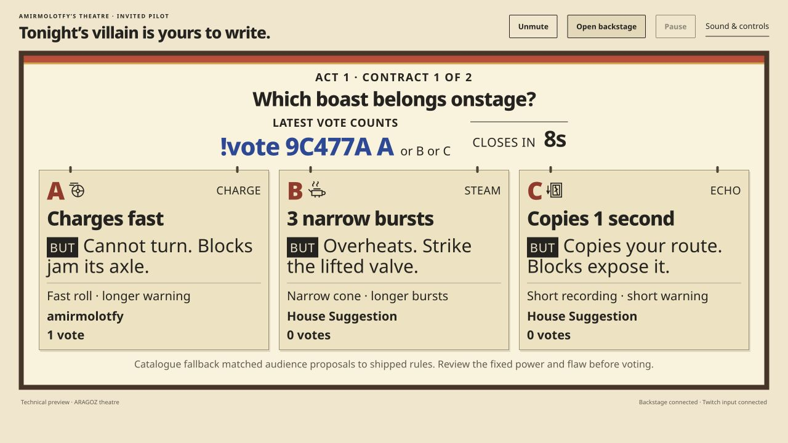
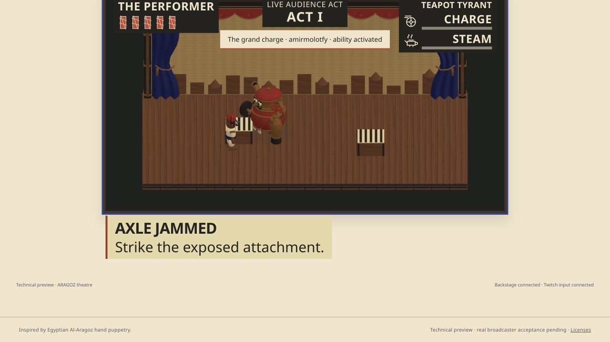
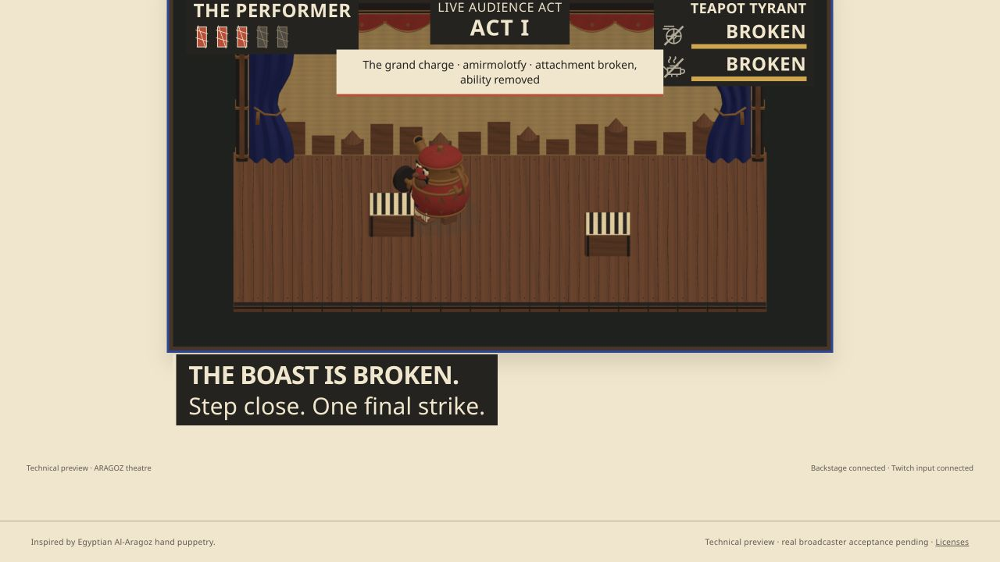
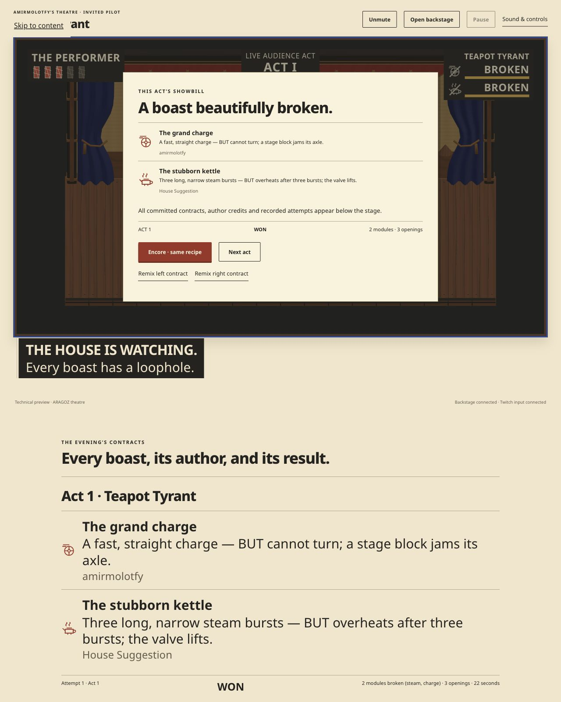
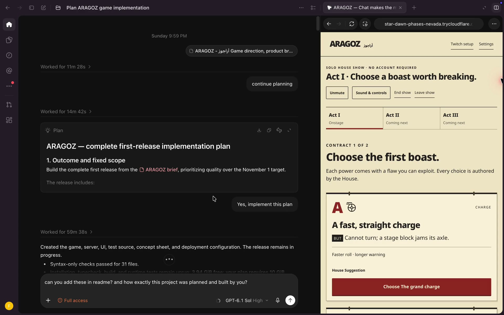

# ARAGOZ — أراجوز

Chat makes the monster. You find the loophole.

ARAGOZ is a browser action game where Twitch viewers propose powers with built-in flaws. The selected contract attaches a physical module; exploiting the flaw opens a counter and breaking the module removes its ability.

## Demo and media

[Watch the narrated demo](https://youtu.be/ej-SDyRD6tE) · [Try the solo House show](https://folks-informative-acting-sanyo.trycloudflare.com/house-show) · [Submission and media provenance](submission/README.md)

*Original generated promotional illustration, not a gameplay screenshot. The public movie is a 2-minute-40-second edit with supplied narration, actual game captures and clearly labelled development/source review. The free live preview depends on the host Mac and network; local setup below works without Twitch or model credentials.*

### Actual gameplay

These are unchanged captures from a genuine Twitch technical test using one agent-operated broadcaster account. They do not represent a multi-person audience playtest.

| The audience chooses a rule | The flaw creates an opening |
| --- | --- |
|  |  |
| **The physical attachment breaks** | **The showbill keeps the author credit** |
|  |  |

The [activation capture](submission/screenshots/02-rule-activates.png) and [media manifest](submission/MEDIA_MANIFEST.json) complete the five-image sequence, with source identities and evidence limits.

### Owner-recorded Codex planning walkthrough

[Watch or download the silent planning recording](docs/media/aragoz-codex-planning.mp4). Amir supplied this recording on 28 October 2026. It shows the actual ARAGOZ Codex conversation, the approved implementation plan and the House page, then scrolls through the project history. This is a retrospective walkthrough, not a continuous recording of every coding step. Historical progress messages in the recording retain their original context. The original capture stays unchanged outside the repository; the linked copy is compressed for delivery. [Recording provenance](evidence/owner-planning-recording-20261028.json).

## How ARAGOZ was planned and built with Codex

The project developed iteratively from 25–28 October 2026. Amir set the product direction and release priorities, approved the plan and visual direction, controlled account permissions and spending, supplied the narration, and recorded the planning walkthrough above. Codex acted as the implementation coordinator: translating the brief into contracts, writing and integrating code, authoring asset scripts, running checks, investigating failures and preparing the submission media. Bounded specialist agents handled concrete assignments such as combat, assets, presentation and backend validation; one coordinator retained ownership of shared contracts and integration. Heavy builds, tests and asset jobs ran one at a time.

Tasks were bounded by concrete files, shared interfaces and acceptance checks. Codex used file/terminal tools for implementation and tests, Blender/Python for editable assets, and supported browser controls for actual UI/provider checks. Specialist changes returned to the coordinator for integration. Findings fed back into the source instead of being treated as automatic acceptance.

The build followed this sequence:

| Step | What was decided or built | Inspect the work |
| --- | --- | --- |
| **1. Define the playable idea** | The brief compared related audience-driven games and made the distinguishing chain explicit: a viewer writes a power **and** a flaw; the flaw creates executable counterplay; breaking the physical part removes its power; credit follows the author. Scope was fixed to one hero, one stage, two shells and three mechanic families. | [Original brief](ARAGOZ_Full_Game_Brief.md), [accepted plan](IMPLEMENTATION_PLAN.md) |
| **2. Establish contracts and authority** | Versioned schemas define recipes, modules, room state, events and assets. A committed recipe has exactly two distinct families and an immutable hash. The server owns identity, ballots, deadlines and accepted results; the browser owns responsive combat. | [Executable schemas](packages/contracts/src/index.ts), [contract notes](CONTENT_SCHEMA.md) |
| **3. Make the rules executable** | A pure TypeScript simulation advances at 60 Hz. Charge locks direction and exposes its axle on a block; steam overheats and exposes its valve; echo follows recorded movement and exposes its mirror on a block. Exposure accelerates break progress. A break cancels that module's damage in the same step; both breaks unlock the final strike. | [Combat simulation](packages/combat/src/index.ts), [mechanic tests](packages/combat/src/index.test.ts) |
| **4. Connect the live show** | Fastify, SQLite and WebSockets manage the show. OAuth and Twitch EventSub receive round-coded proposals/votes. Private review, hard cutoffs, replacement votes and idempotent event uploads feed the public stage. React handles menus; Babylon renders the locally packaged 3D theatre. | [Twitch transport](apps/server/src/twitch.ts), [show engine](apps/server/src/engine.ts), [live UI](apps/web/src/Live.tsx), [stage](apps/web/src/theatre.ts) |
| **5. Produce and admit the art** | Built-in image generation produced the concept sheet; Amir approved its direction on 26 October. Codex-authored Blender/Python scripts then produced seven original editable assets, materials, rigid animation, sockets and GLB exports. Static checks and Babylon inspection preceded runtime admission. No paid Meshy batch was used. | [Art bible](ART_BIBLE.md), [approval](assets/concepts/approval.json), [Blender source script](scripts/blender/build_local_kit.py), [asset admission](assets/production/local-kit-admission.json), [rights](ASSET_LICENSES.md) |
| **6. Complete the product around combat** | Three acts, assembly, tutorial, distinct outcomes, Encore, one-slot Remix, attribution and showbills were integrated with accessibility controls and recovery. When Twitch setup was delayed, the complete account-free House show progressed independently. It labels authored content as House and keeps local saves separate from server-owned shows. | [House show](apps/web/src/house-show.ts), [controls/settings](apps/web/src/settings.ts), [server persistence](apps/server/src/store.ts) |
| **7. Test, observe, repair** | Unit/server tests check rules and permissions; Playwright exercises browser flows; actual M1/OBS sessions measure presentation; genuine Twitch tests check the provider chain. Findings changed the code: arena framing, Retina presentation, render scheduling, final-strike assistance and a Pause/event-upload revision race. The latter was reproduced with a held real browser request and fixed with one per-room mutation queue. | [Test plan](TEST_PLAN.md), [performance](ops/PERFORMANCE_REPORT.md), [real Twitch report](ops/TWITCH_LIVE_VALIDATION.md), [pause-race fix](ops/LIVE_PAUSE_QUEUE_FIX.md) |
| **8. Package the preview and explain it** | A no-cost Mac-hosted HTTPS preview preserves SQLite data locally. Source, rights and run instructions are public. Codex assembled the cover, actual screenshots, edit, captions and supplied narration into the demo, then verified media decodes and archive hashes. Genuine human acceptance remains a separate release gate. | [Hosting](ops/NO_COST_HOSTING.md), [media receipt](evidence/submission-media-20261028.json), [delivery](submission/DELIVERY.md) |

The development agent and the runtime game have different roles. **Codex helped build ARAGOZ; a language model does not run the fight.** Current live proposals match a strict supported grammar to six authored profiles. The optional OpenAI structured-mapping/moderation path is implemented and mock-tested, but paid runtime calls remain disabled under the owner's no-spending instruction. The shipped game does not generate arbitrary mechanics, code or meshes from chat.

This was a sequence of implementation and repair steps, not a single prompt producing an accepted release. [BUILD_JOURNAL.md](BUILD_JOURNAL.md) records dated decisions and checks; [Git history](https://github.com/AmirmLotfy/aragoz/commits/main/) shows the committed changes. Passing local or mocked tests is kept distinct from real Twitch, OBS, hosted and human evidence. No first-time host/viewer acceptance session is claimed.

## Current status and evidence

**Status:** functioning technical preview: complete three-act House show, rehearsal, three mechanic families, two shells, physical breaks, outcomes, Encore/Remix and recovery. Source7fabb61 passed typecheck/release build,171unit/server tests and one28/28browser run; four final affected typography cases passed separately. Seven original Blender GLBs are admitted. Actual M1/OBS measurements recommend1080p30presentation with unchanged60Hzsimulation; those recordings retain their source limits. On27October, one genuine Twitch account operated by the agent completed OAuth/chat/proposal/vote, a credited accepted win, real token refresh, encrypted backup/restore and authenticated restart. See [real Twitch evidence](ops/TWITCH_LIVE_VALIDATION.md), [performance](ops/PERFORMANCE_REPORT.md) and [remaining work](REMAINING_WORK.md). Genuine host/viewer acceptance and specific remaining provider/isolation cases remain open; the full release is not yet accepted.

**Hackathon preparation:** [submission packet](submission/README.md) includes the Devpost story,3:2promotional cover, five actual screenshots,160-second captioned review video and owner voiceover script. The supplied voice is integrated into the final narrated movie; see [voice integration](submission/VOICE_INTEGRATION.md). The existing Devpost draft now contains the saved story, confirmed form answers, approved cover/gallery and links. New local narrated masters include actual Twitch assembly and charge-break motion, with original narration preserved. The build chapter shows actual GitHub source/commit review of a Codex-built fix, explicitly not Codex app footage. Public judge source access is verified; the [captioned movie is public](https://youtu.be/ej-SDyRD6tE) and saved in the draft. Eligibility/final entry remain pending; see [draft status](submission/DEVPOST_DRAFT_STATUS.md). The entry remains Draft3/5; the owner will complete eligibility manually.

On28October, [a pause/upload revision race](ops/LIVE_PAUSE_QUEUE_FIX.md) was fixed and pushed as1f4231e. Typecheck, release build, the new queue unit check and all3live browser fixture cases passed. This updates the affected frontend evidence; it is not a new full-suite/provider/human acceptance claim.

**No spending:** the owner prohibited payments on26October2026 and explicitly approved public visibility for this repository on28October. The repository is public; anonymous README access was verified. Model/Meshy calls remain off. Use the existing Mac plus the temporary HTTPS tunnel in [the no-cost hosting runbook](ops/NO_COST_HOSTING.md). The paid Render design is archived and unapproved; no automatic billable CI is configured.

On 28 October, a subsequent [restart-ledger fix](ops/RESTART_RECOVERY_FIX.md) made repeated restart and the first control claim reuse the unplayed recovery attempt. Its verification includes 173 unit/server checks and 43 HTTP checks on an isolated restore of genuine data. Browser/provider/human evidence boundaries are recorded in that report.

## Local setup

Use Node24 LTS and npm. The user superseded the initial fixed10GiB floor on26October2026. Run `node scripts/check-resources.mjs --job install` (or verify/build/browser/blender) for a bounded next-job estimate and working reserve. Split work when resources are tight; preserve unrelated projects and report any actual ENOSPC action precisely.

Use the pinned Node24.19.0 version in .nvmrc. Run `npm ci --ignore-scripts` with the checked-in lockfile, then `npm run typecheck`, `npm test`, `npm run build:release`, and `npm start`, one at a time. Production serves frontend and API together at http://localhost:3000. The Docker base image is pinned to a verified registry digest; production-only dependencies also passed a separate local packaging/startup check.

The complete solo House show at `/house-show` and the one-encounter rehearsal at `/rehearse` require no environment file, Twitch account, model key or audience. In House show, choose two different attachments per act, play three acts, then keep the cumulative showbill. Encore reuses the recipe; Remix replaces one attachment. Saves in the same browser and web origin retain the show, and refresh or explicit window takeover restarts unfinished combat safely. Download the showbill before replacing a local save. Storage failure is visibly labelled and permits memory-only play.

Public rehearsal requires no environment file, Twitch account, model key or audience. Controls: WASD/arrows move, mouse/J strike, Space dodge, Escape pause. Remap controls and adjust audio/comfort/quality from Settings. The three House presets exercise charge/steam, charge/echo and steam/echo. Every simulated/preset contribution is labelled House.

For frontend development, run `npm run dev` and `npm run dev:web` in separate terminals. Set PUBLIC_ORIGIN=http://localhost:5173 and TWITCH_REDIRECT_URI=http://localhost:5173/api/auth/twitch/callback in your ignored.env so Vite's API/WebSocket proxy and origin checks agree. The single-origin production path uses port3000 instead.

## Invited Twitch hosting

Copy.env.example to.env locally and configure the registered Twitch app, its exact callback, an encryption key and invited broadcaster IDs. The no-cost launcher creates a private encryption key automatically in data/public-preview/credentials.key. Preserve it securely with backups. Never paste real keys into chat or commit the.env.

The browser uses OAuth; it never asks for a Twitch password. Read scope is user:read:chat. Optional help replies request user:write:chat only when selected. Shared Chat is outside the pilot. Setup confirms the actual stage/audio and an incoming `!aragoz CODE` test before launch.

Open private backstage separately and capture only the play window in OBS. Backstage reviews proposals/adaptations and advances cues without a second3D simulation. Commands display the current round code: `!make ABC123 charges but cannot turn`, then `!vote ABC123 A` (or B/C). Codes change per ballot/restart. One effective suggestion/vote per viewer; edits replace prior valid entries. House fallback is always explicitly credited.

OpenAI calls stay off until OPENAI_API_KEY and a nonzero approved MODEL_DAILY_REQUEST_LIMIT are configured. The requested model is gpt-6-luna. This is an operator limit across moderation/compile requests, not a promise of a particular bill. The current owner instruction prohibits all spending; do not enable model calls, paid assets or paid hosting.

## Verification and operations

- `npm run typecheck` / `npm test` / `npm run build`: source, state and bundle checks.
- Start the built server, then `npm run test:browser`: actual rehearsal and authenticated HTTP/WebSocket/UI checks, one worker. The local Google Chrome executable is reused when present; set PLAYWRIGHT_CHROMIUM_PATH elsewhere. Live browser tests use an explicitly labelled fixture harness with no production authentication bypass and no provider networking.
- `npm run check:assets`: provenance/payload audit. `node scripts/check-assets.mjs --require-final` also requires every final asset's admission evidence.
- `npm run test:assets`: small dependency-free GLB-format and local candidate-serving fixture tests using Node24. These establish static/tooling behavior, not gameplay or engine acceptance.
- `npm run build:release`: requires every final runtime asset's recorded admission before running the normal checked build. The normal build can still produce an honestly labelled development preview.
- `npm run test:container`: actual Linux image startup, static compression, private API denial, durable volume replacement, online backup and isolated restoration. Requires a Docker context/image; defaults are documented in tests/container/smoke.mjs.
- `npm run preview:public`: zero-cost public HTTPS preview on this computer; see ops/NO_COST_HOSTING.md.
- `npm run check:resources`: the bounded local next-job estimate.
- `node --env-file-if-exists=.env apps/server/src/backup.ts /absolute/new-backup.sqlite`: online backup of this command's configured database to a fresh path. For the public launcher, explicitly select its database using [the public backup instructions](ops/NO_COST_HOSTING.md#backups-and-evidence). Follow apps/server/README.md for safe restoration.

Short M1 Metal browser samples and a keyboard-driven counter/break/final-strike/Encore playthrough are in evidence/browser. They are labelled local/AI-led and establish no hosted/OBS/human acceptance. A paused stage renders at15fps to reduce idle GPU work; active combat retains fixed60Hz simulation and the selected60/30fps presentation setting.

Public rendering loads only locally admitted runtime assets. Concepts are not included in the deployment image. The accepted brief, plan, art bible, content schema, rights log, test plan and build journal live at the repository root. The public technical preview uses an account-free tunnel with local durable SQLite. DEPLOYMENT_REVIEW.md records current ownership/no-spend rules; ops/archive/render.paid-unapproved.yaml preserves only the historical paid design. Compressed static assets negotiate Brotli/gzip with byte-identical fallback.

The subsequent [hosted recovery checkpoint](ops/HOSTED_RECOVERY_20261028.md) records31/31 muted browser checks, genuine two-window/offline operator checks and repeated backend restart verification. These remain distinct from human acceptance.

Current-source LinuxARM64 packaging also passed the [28 October build](evidence/linux-container-build-20261028.json) and [13 container smoke checks](evidence/linux-container-smoke-20261028.json), including container replacement and backup restoration.
